# Build a voltage sweep with measurements at each point

This walkthrough uses GATE's **simulated converter bench**. You will command **8, 9, 10, 11 and 12 V**, hold the simulated output load at **0.1 A**, wait **1 second** at each setpoint, and average **3 readings** of four measurements at every point. You will also calculate input power and plot output voltage against commanded input voltage.

The screenshots show the GUI on `codex/gui-test-builder`. Launch that version with `python3 -m gate gui` from the checkout. Start the background service in **Devices & Settings** if it is offline. The settling time below assumes the service polling interval is **1 second or less**.

**Shortcut:** the complete [test JSON](examples/voltage-sweep.json) can be loaded through **Edit Test… → Advanced JSON → Load JSON into builder**, once the experiment has the `supply` and `load` equipment roles. The steps below build the same definition using the forms.

## 1. Create an experiment using the converter arrangement

Click **New Experiment…** in the sidebar, then **Use Buck Converter Example** on **Overview**. Change the experiment name to **Voltage sweep walkthrough**. The example supplies the DUT, the `supply` and `load` roles, and four wiring connections. Leave those equipment and wiring definitions in place. The optional observation roles can stay unassigned.

These are simulated connections for this walkthrough. Using real equipment requires drivers with verified output-control support and operating limits appropriate to the actual DUT.

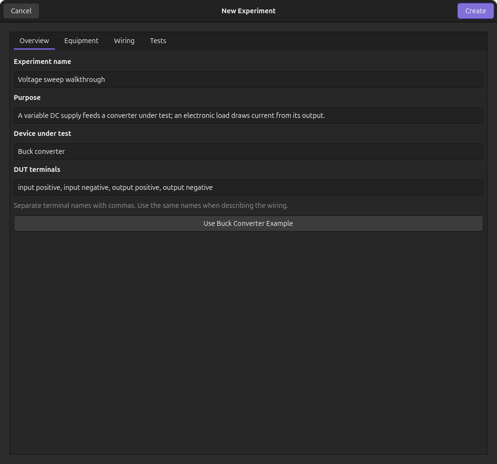

## 2. Add a blank measurement test

Open **Tests**. Remove the two example tests using their bin buttons, then click **Add Test**. Set **Test name** to **Voltage sweep**, keep **Starting template → Measurement capture**, and enter a short description, for example “Sweep input voltage and measure the converter at each point.” Click **Create**.

This gives you one test to configure; you will add its sweep and measurements next.

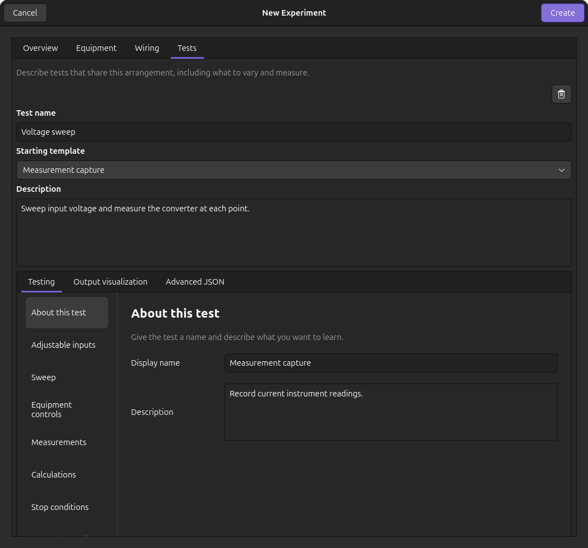

## 3. Assign the simulated equipment

In the saved experiment, open **Instruments** and click **Add Simulated Converter Bench**. Choose the simulated converter supply for **Input supply** and the simulated electronic load for **Output load**. Leave the optional temperature and scope roles unassigned.

Next open **Parameters**, select **Voltage sweep**, and click **Edit Test…**. In **Testing → About this test**, set **Display name** to **Voltage sweep with point measurements** and describe the purpose of the sweep.

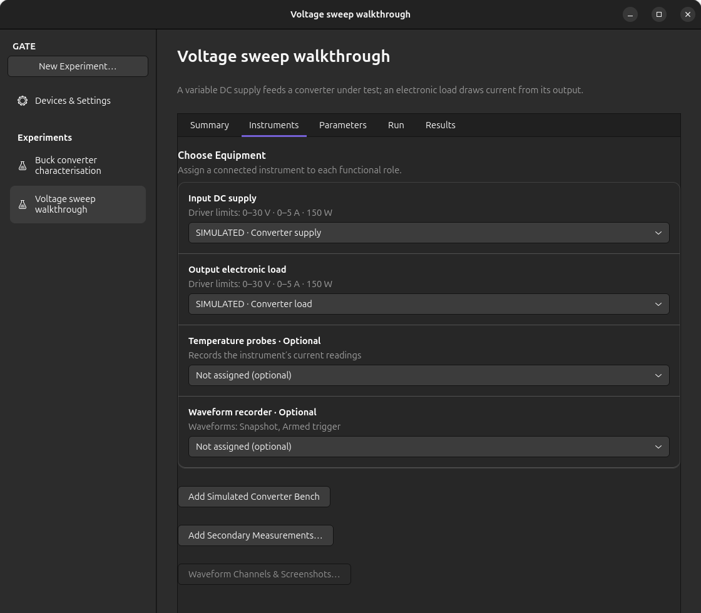

## 4. Create three adjustable voltage inputs

In **Testing → Adjustable inputs**, remove the capture template's **Number of polling cycles** parameter. Click **Add parameter** three times and fill in these values. Open each card to edit it; **Formula name** is the identifier other settings will refer to.

| Formula name | Display name | Units | Starting value | Minimum | Maximum | Increment | Value type |
|---|---|---|---:|---:|---:|---:|---|
| `start_v` | Start voltage | V | 8 | 8 | 12 | 1 | Decimal number |
| `stop_v` | Stop voltage | V | 12 | 8 | 12 | 1 | Decimal number |
| `step_v` | Voltage increment | V | 1 | 0.1 | 4 | 0.1 | Decimal number |

The parameter **Increment** controls the increment of the run-time input widget. The parameter named `step_v` supplies the actual sweep increment in the next step.

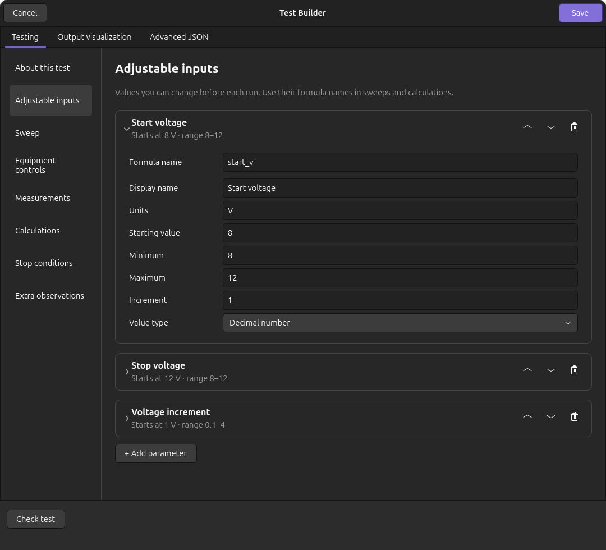

## 5. Define the voltage sweep

Open **Sweep**, click **Add sweep**, and enter:

| Setting | Value |
|---|---|
| Formula name | `command_v` |
| Display name | Commanded input voltage |
| Units | V |
| Sweep points | Evenly spaced |
| From | `start_v` |
| To | `stop_v` |
| Increment | `step_v` |
| Apply sweep values to equipment | On |
| Equipment | Input supply (`supply`) |
| Setting | Voltage |

Enter the three parameter names directly, without quotes. The result is **8 → 9 → 10 → 11 → 12 V**, including both endpoints. Keep only this one sweep axis: the load will be fixed rather than swept.

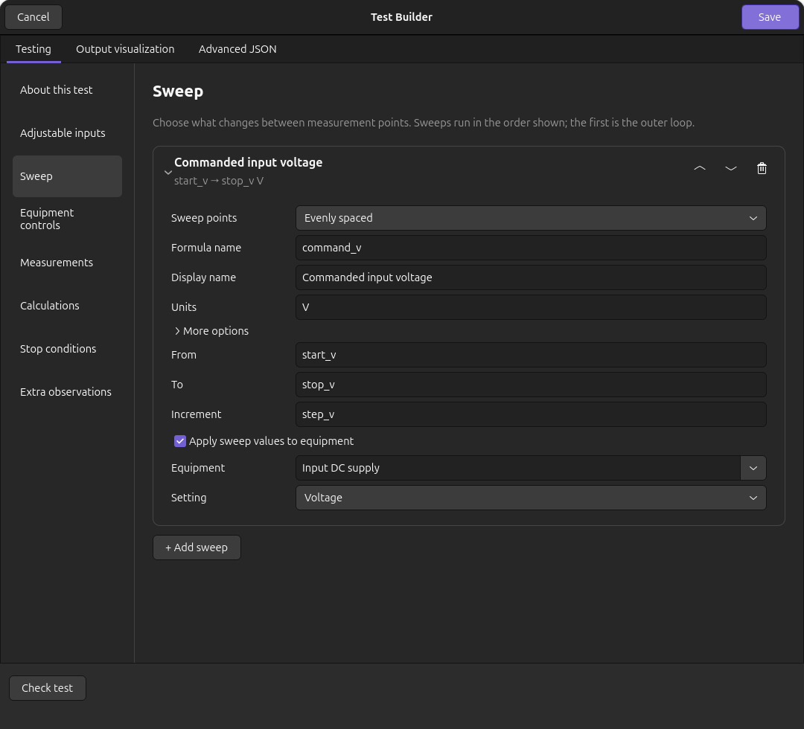

## 6. Declare the enabled outputs and their limits

Open **Equipment controls**. Under **Enabled equipment**, add **Input supply** (`supply`) followed by **Output load** (`load`). Under **Operating limits**, add two entries whose formula names match the equipment role identifiers:

| Formula name / equipment role | Voltage | Current |
|---|---:|---:|
| `supply` | 12 | 0.5 |
| `load` | 5.5 | 0.1 |

These are the maximum planned operating envelopes. The load's voltage limit is the converter output voltage envelope, rather than the 12 V input sweep limit. Declaring these limits does not itself set an instrument's current limit or turn outputs on.

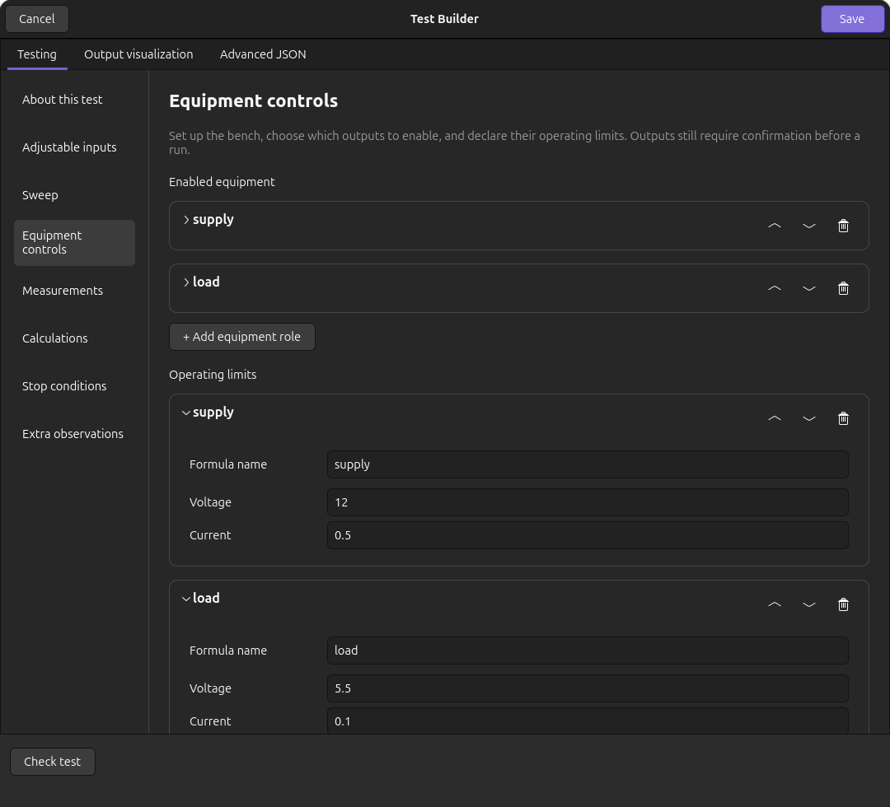

## 7. Set the supply current limit and fixed load

On the same page, scroll to **Setup**. Click **Add setup action** twice:

| Equipment | Setting | Value |
|---|---|---:|
| Input supply (`supply`) | Current limit | 0.5 |
| Output load (`load`) | Current | 0.1 |

These actions run once, while outputs are disabled. Leave **Before each point** empty: this example has a fixed load and only sweeps supply voltage.

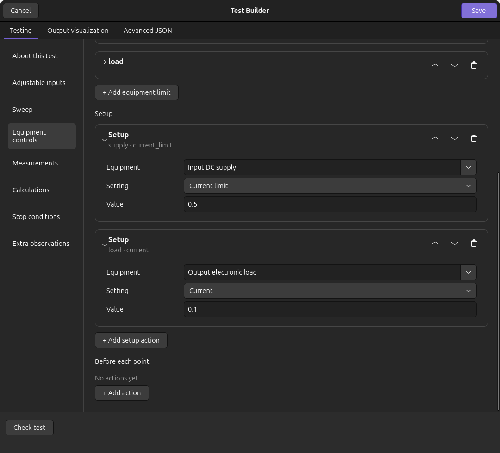

## 8. Choose the measurements to acquire

Open **Measurements** and click **Add measurement** four times. Choose **Read from → Standard measurement** for each entry and use the settings below.

| Formula name | Display name | Units | Equipment | Measurement |
|---|---|---|---|---|
| `input_voltage_v` | Input voltage | V | Input supply | voltage |
| `input_current_a` | Input current | A | Input supply | current |
| `output_voltage_v` | Output voltage | V | Output load | voltage |
| `output_current_a` | Output current | A | Output load | current |

Keep **Stop if unavailable** on for all four readings. These use the simulated supply/load readbacks; you do not need separate meters for this example. For a real meter, define and assign its own equipment role and select its supported measurement or instrument channel instead.

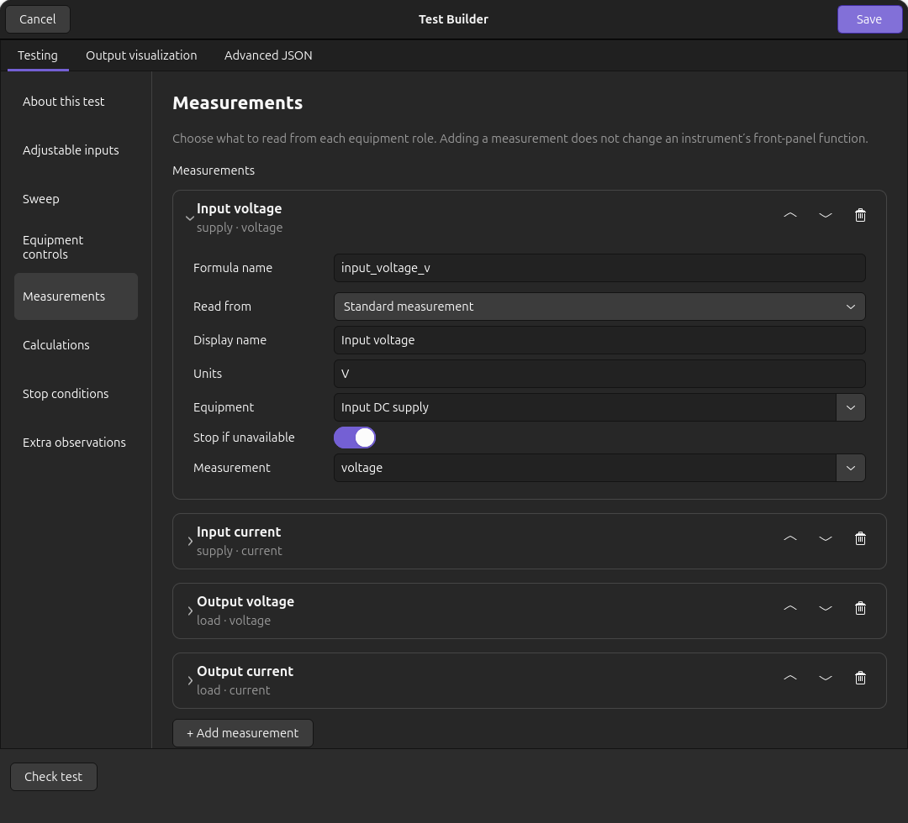

## 9. Configure acquisition at each point

Scroll down on **Measurements** to **Acquisition**:

| Setting | Value |
|---|---|
| Wait before measuring (s) | 1 |
| Readings per point | 3 |
| Capture points | 1 |
| Include all instrument readings | Off |
| Missing readings | Stop the test |

**Capture points must be 1 when sweep axes are present.** The five sweep setpoints determine the number of result rows. “Readings per point = 3” means three successive polling cycles at each setpoint; each result row contains their averaged measurements. It does not create three sweep passes. The one-second wait must be at least the service polling interval for output tests.

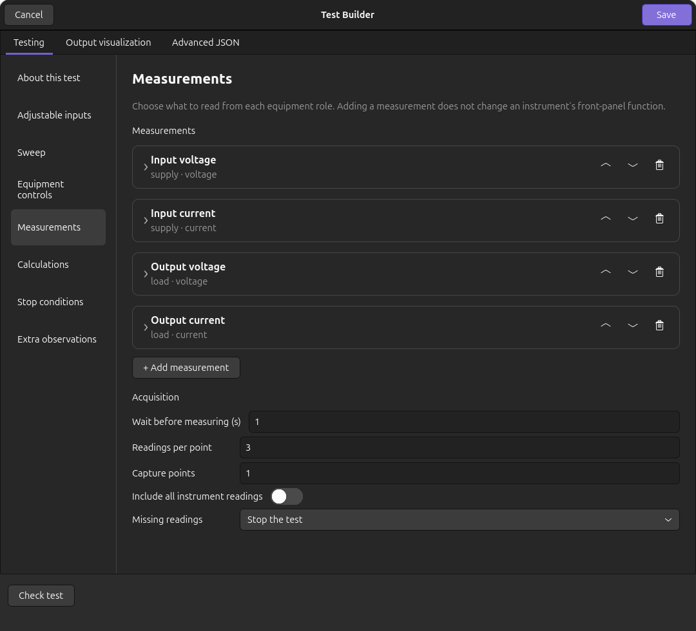

## 10. Add a calculated result and a stop condition

In **Calculations**, click **Add calculation** and set:

| Setting | Value |
|---|---|
| Formula name | `input_power_w` |
| Display name | Input power |
| Units | W |
| Expression | `input_voltage_v * input_current_a` |
| Calculate using | Each reading, then average |

This computes power from each voltage/current pair and then averages the three power values. Leave **Group results** off.

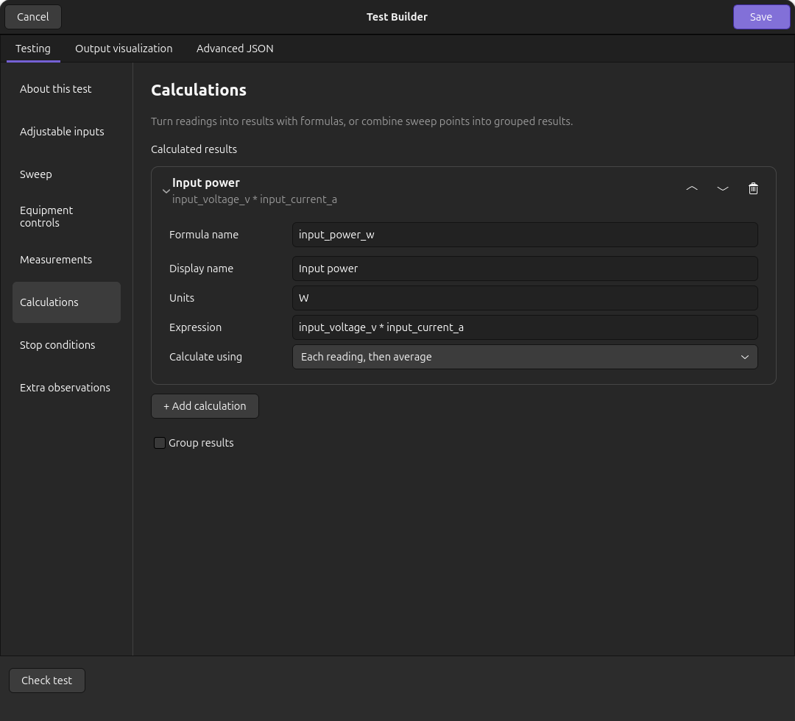

Then open **Stop conditions**, click **Add condition**, and set **When to check → Each reading**, **Expression → `input_current_a <= 0.5`**, and **Message → Input current exceeded 0.5 A**. Leave **End the test early** off. This check ends the test as a failure if a reading exceeds the configured threshold.

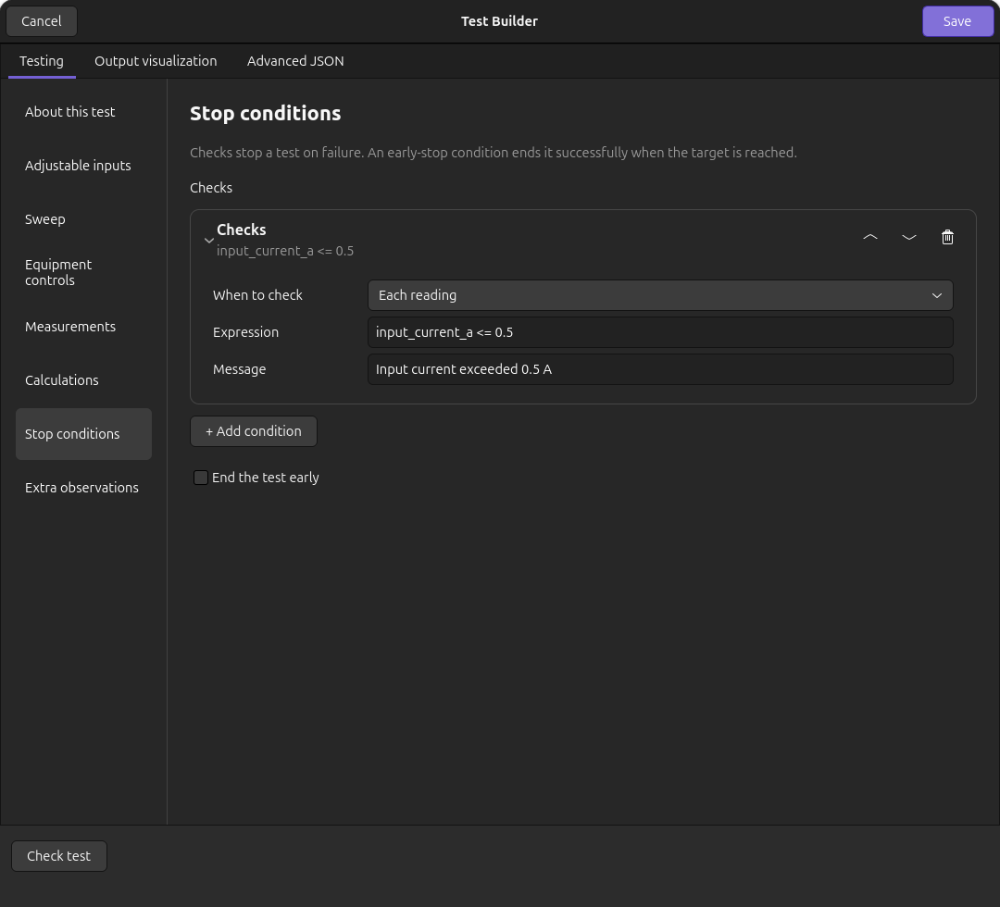

## 11. Configure the chart and result table

Switch to **Output visualization → Charts**, click **Add chart**, and choose:

| Setting | Value |
|---|---|
| Style | Line chart |
| Dataset | Measured points |
| Horizontal axis | Commanded input voltage (`command_v`) |
| Vertical axis | Output voltage (`output_voltage_v`) |
| Chart title | Output voltage versus input voltage |

Leave **More options** at its defaults. The layout preview shows labels; the actual measured curve appears after the run.

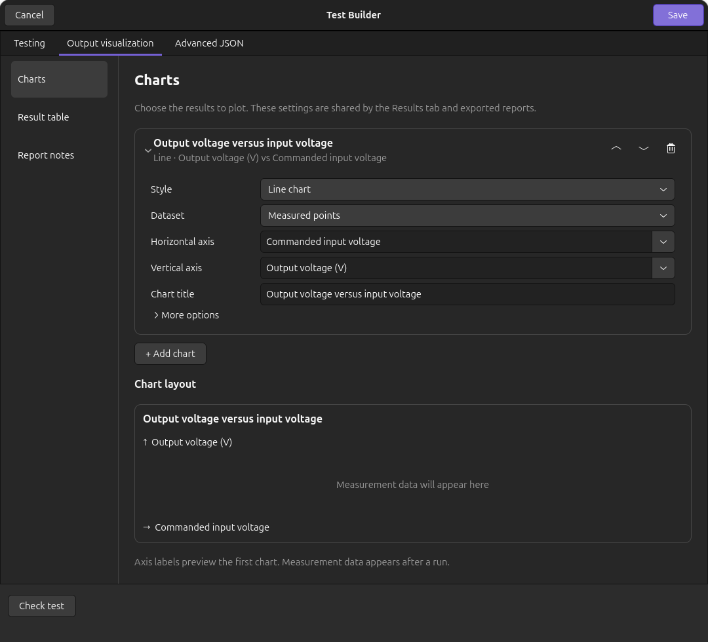

Open **Result table**, select **Measured points**, expand **More options**, and enable **Choose columns**. Add these columns in order:

1. `command_v`
2. `input_voltage_v`
3. `input_current_a`
4. `output_voltage_v`
5. `output_current_a`
6. `input_power_w`
7. `quality`

Use the column pickers and arrows to choose and arrange them. Leaving **Choose columns** off would instead use the default column selection.

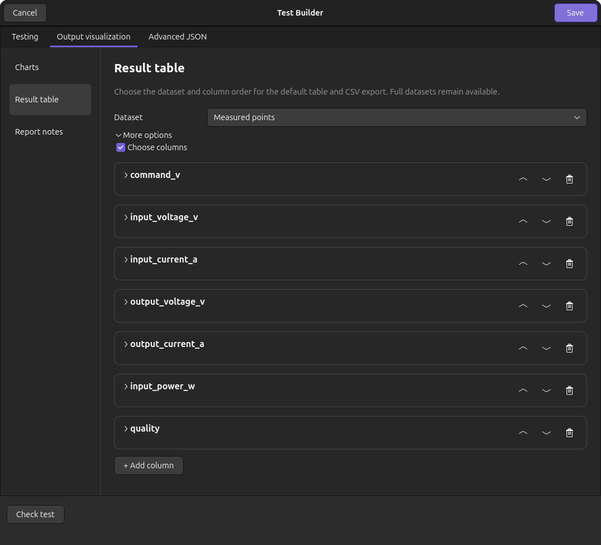

## 12. Validate, save and run

Click **Check test** at the bottom. You should see **Definition valid · 5 points at starting values**. Correct any reported errors, then click **Save**. Definition checking does not replace the equipment checks performed before execution.

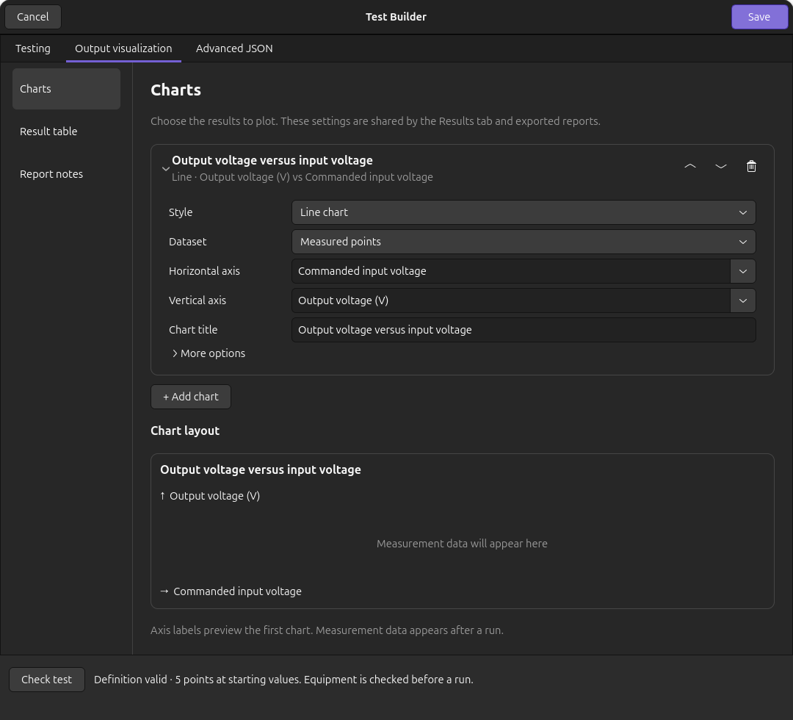

Back in the experiment, open **Run**. Ensure **Voltage sweep** is the only selected test and that the equipment summary names the simulated supply and load. Check the wiring/limits confirmation, then click **Run Selected Tests & Enable Outputs**. This explicitly enables the simulated outputs. **Stop Tests** cancels the run.

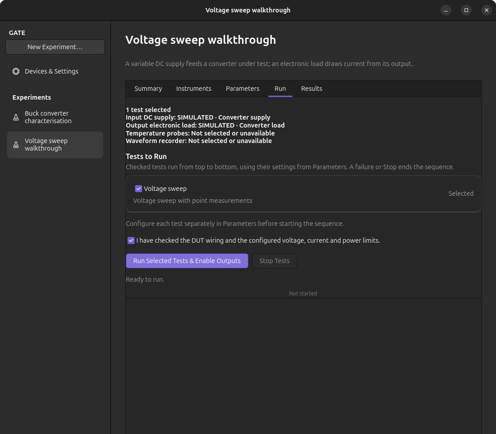

## 13. Inspect the results

When the run completes, open **Results**. Expect **five rows**, with commanded input voltages **8, 9, 10, 11 and 12 V**. Each row contains the averaged voltage/current readings, the input-power result and a quality field. The chart plots output voltage against the commanded input voltage. The simulated converter should keep its output near 5 V over this range; readback values need not exactly equal the commanded settings.

Use **Open Full Report** or **Export CSV…** to inspect all rows outside the application. Raw samples are retained separately from the averaged point results. Instrument reads are sequential software polling, not simultaneous hardware-triggered acquisition.

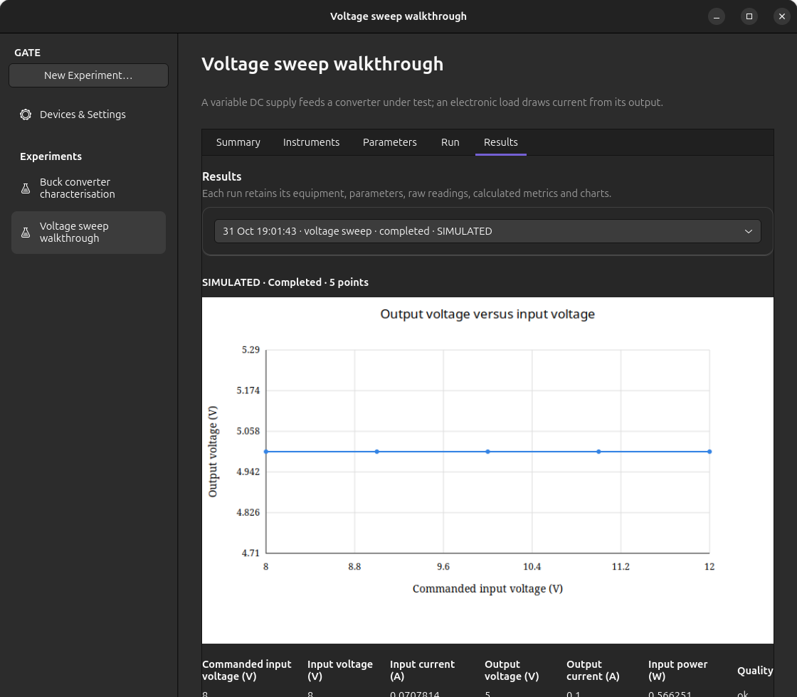

Scroll down to see all five rows and the report/export buttons:

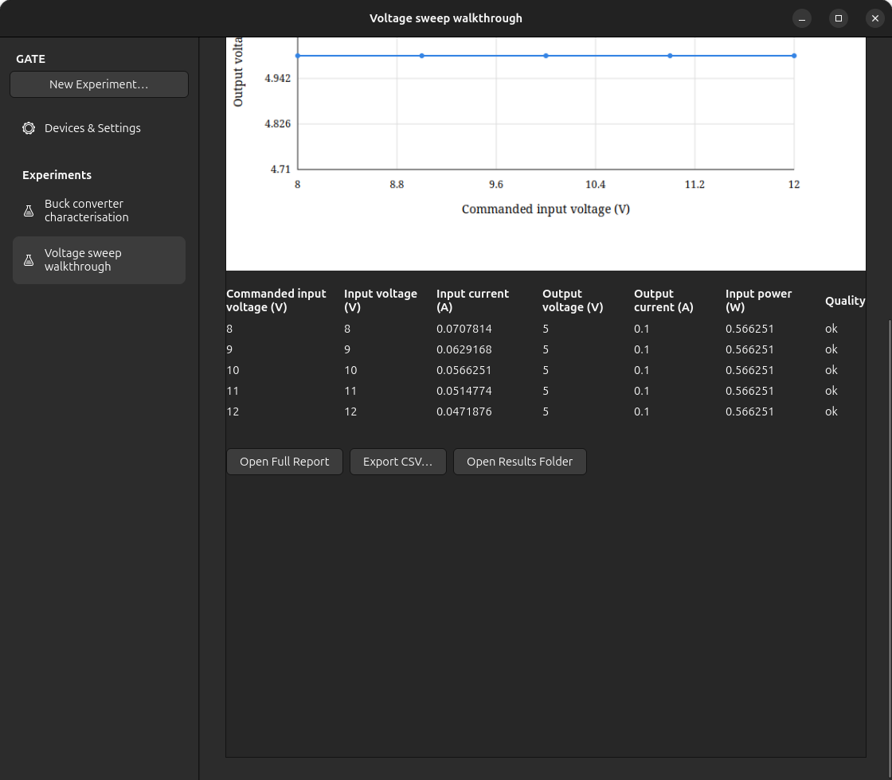

This guide's example was run on the simulated bench and checked to produce five completed measurement points.
